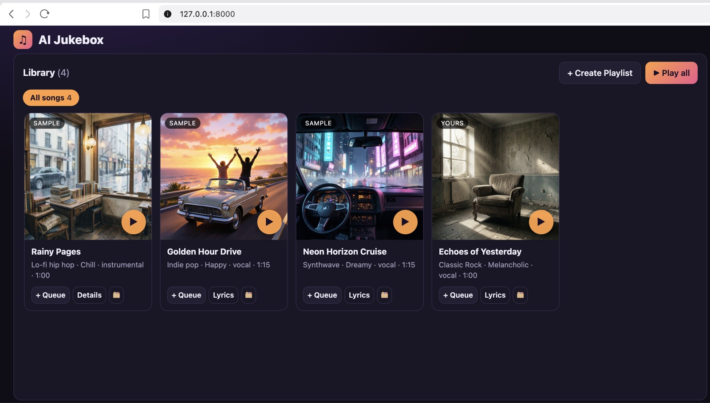
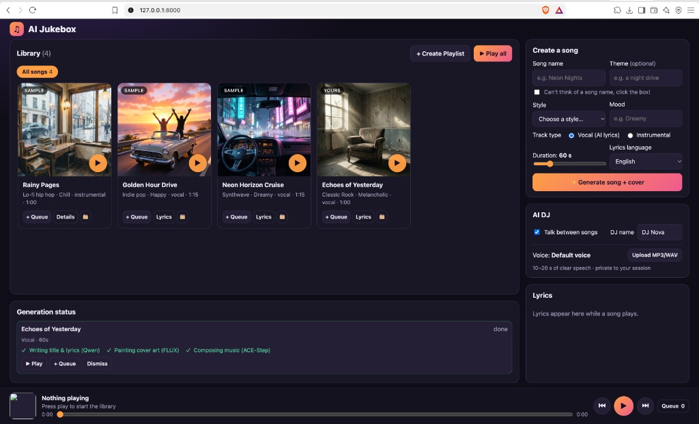
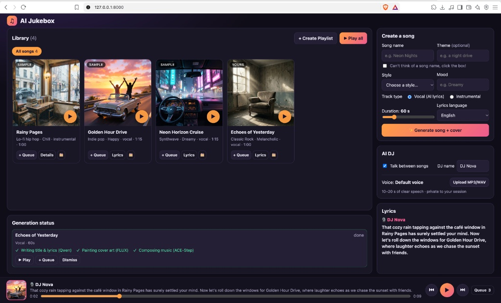
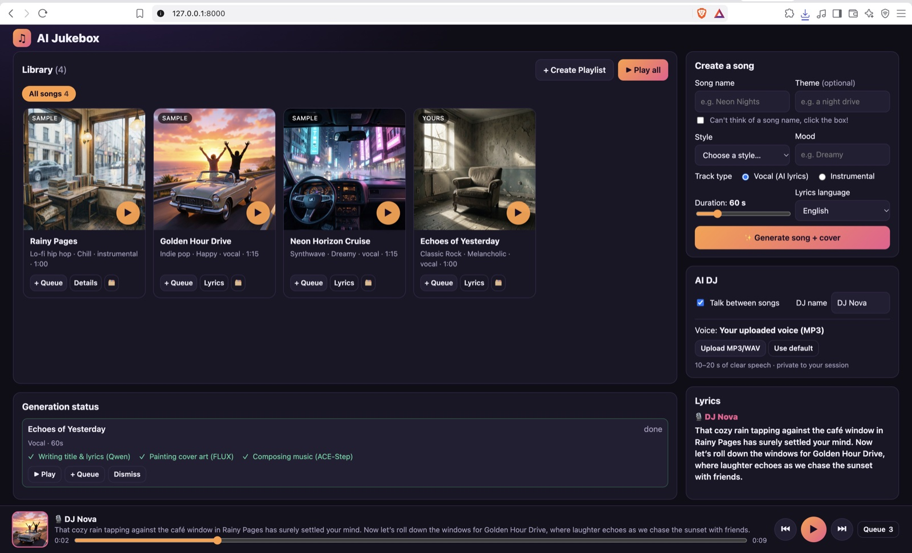
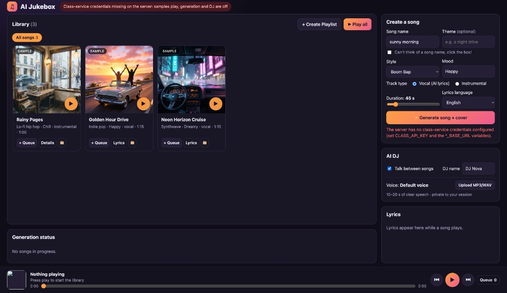

# AI Jukebox — MBAX 6418 Assignment 3

A web app that (1) generates custom songs, (2) paints matching cover art, and (3) plays the
library with an AI DJ who talks between tracks. All of it runs on the class services:

| Feature | Class service | Port |
|---|---|---|
| Song titles, lyrics, music captions, cover prompts, DJ scripts | Qwen3.6-35B-A3B | 9001 |
| Cover art | FLUX.2 klein 4B | 9006 |
| Music (instrumental and vocal) | ACE-Step 1.5 XL Turbo | 9007 |
| DJ speech (default or uploaded voice) | Chatterbox Multilingual V3 | 9008 |

No paid services are used, and port 9000 is not used.

**Contents:** [Quick start](#quick-start-launch-procedure) · [Setup and use](#setup-and-use) (dependencies, configuration, launch) · [Using the app](#using-the-app) · [Sample generation](#sample-generation) · [Tests](#tests) · [Key problem: endpoints](#key-problem-connecting-to-the-correct-endpoints) · [Design judgment](#design-judgment) · [Screenshots](#screenshots)

## Quick start (launch procedure)

1. **Download the ZIP** from GitHub (**Code → Download ZIP**) onto your machine.
2. **Extract all the files** into a single folder.
3. **Add the class endpoints file.** Copy the class's `class-endpoints.txt` into that folder, next to `README.md`. The official file already contains the API key, so nothing else needs to be typed in.
4. **Open a terminal in the folder:**
   - macOS: right-click the folder and choose **New Terminal at Folder**.
   - Windows 11: open the folder in File Explorer, right-click an empty spot and choose **Open in Terminal**.
   - Windows 10: open the folder in File Explorer, click the address bar, type `cmd` and press Enter.
5. **Run the launcher:**
   - macOS / Linux: `bash start.sh`
   - Windows: `start.bat` (or just double-click `start.bat` in File Explorer; no terminal needed)
6. **If errors pop up, the most likely cause is the class endpoints.** This was the main issue we ran into (see [Key problem](#key-problem-connecting-to-the-correct-endpoints)). Where to look:
   - The terminal prints an `OK` or `FAIL` line for each of the four services, with a hint such as "key rejected" or "cannot connect".
   - The page shows a red banner naming any missing setting.
   - The [Troubleshooting](#troubleshooting) table lists the fixes.
   - You can also paste the terminal message into Claude, Hermes, ChatGPT or another assistant and work through connecting the endpoints together.

   Once the endpoints are connected, repeat steps 4–5.
7. **Let the terminal run.** The first run installs everything, which takes about a minute. The terminal then shows the local link (**http://localhost:8000**) and opens it in your default browser.
8. **Enjoy producing music!** To stop the app, press **Ctrl+C** in the terminal. To start it again, repeat steps 4–5; later starts take a few seconds.

If `class-endpoints.txt` has no key, the launcher asks you to paste it once and saves it in `.env`. Neither file is ever uploaded. The launcher uses [uv](https://docs.astral.sh/uv/) if it is installed, and otherwise Python 3.12+ with pip. To do the same steps by hand, see [Launch by hand](#launch-by-hand).

## How it works

```
Browser (jukebox/static)                 Server (FastAPI, jukebox/)                  Class services
─────────────────────────                ──────────────────────────                  ──────────────
Create-a-song form ── POST /api/generate ─▶ JobManager (background thread)
                                           1. plan_song ───────────────────────────▶ Qwen  :9001
                                              title, lyrics, music caption, cover prompt
                                           2. in parallel: cover ──────────────────▶ FLUX  :9006
                                                           music ──────────────────▶ ACE-Step :9007
Status panel ◀─ GET /api/jobs (polling) ── 3. song added to the library (DATA_DIR/tracks)
Player: song ▶ DJ ▶ song ▶ …
  next DJ clip prefetched ─ POST /api/dj ─▶ write_dj_line ─────────────────────────▶ Qwen  :9001
                                           speak (default or uploaded voice) ──────▶ Chatterbox :9008
Voice upload ─────────── POST /api/voice ─▶ DATA_DIR/voices/<browser session> (never served back)
```

- **No overlap:** a single `<audio>` element plays songs and DJ clips one after another, so music and speech can never play at the same time.
- **Commentary is ready on time:** the DJ clip for the next transition is requested as soon as a song starts.
- **Credentials stay server-side:** the API key and service URLs never reach the browser, and `redact()` scrubs the key from logs and error messages.

## Setup and use

### Dependencies and additional software

| What | Details |
|---|---|
| Python | 3.12 or newer. Tested with 3.12 (uv) and 3.13 (pip) on macOS. |
| Package installer | [uv](https://docs.astral.sh/uv/) (recommended), or the `pip` that comes with Python |
| Python packages | `fastapi`, `uvicorn`, `httpx`, `python-dotenv`, `pillow`, `python-multipart`, `mutagen`. Exact versions are pinned in `uv.lock` and `requirements.txt`, and installed automatically. |
| Other software | **None.** No ffmpeg, Node.js, database or Docker. Any modern web browser works. |
| Network | Access to the class services (ports 9001, 9006, 9007, 9008) |

### Configuration (endpoints and credentials)

Launching *runs* the app. Configuration *tells* the app which class services to call and gives it the key. The app needs five settings:

| Setting | What it is | Example (placeholder) |
|---|---|---|
| `CLASS_API_KEY` | The class API key. Required. | `replace-me` |
| `LLM_BASE_URL` | Qwen, text (port 9001) | `http://example.com:9001/v1` |
| `IMAGE_BASE_URL` | FLUX, cover art (port 9006) | `http://example.com:9006/v1` |
| `MUSIC_BASE_URL` | ACE-Step, music (port 9007) | `http://example.com:9007` |
| `TTS_BASE_URL` | Chatterbox, DJ voice (port 9008) | `http://example.com:9008/v1` |

**Where the settings come from**, highest priority first:
1. Environment variables.
2. `.env` in the project folder.
3. `class-endpoints.txt` in the project folder.

**The easiest setup is to drop the class's `class-endpoints.txt` into the folder.** The app reads the official file's layout: one block per service with `Base URL:` and `API Key:` lines. From it the app takes the URLs for ports 9001, 9006, 9007 and 9008 and the key from those blocks, and ignores everything else (for example the 9000 Hermes block). Simple `KEY=value` lines work too. To use a different key, set `CLASS_API_KEY` in `.env`; it takes priority.

**The app forgives common mistakes:**
- URLs work with or without a trailing `/v1`, and spaces around values are ignored.
- Unedited `example.com` placeholders count as "not set", so they never hide the real URLs.
- Other common names are accepted, e.g. `SPEECH_BASE_URL` or `FLUX_BASE_URL` for the URLs and `API_KEY` for the key. Any other `…_URL` setting is matched to its service by its port.
- The model names have correct defaults and normally need no setting.

**Supplying the key securely:**
- The key lives only in `.env` (or an environment variable) on the computer that runs the app.
- `.env` and `class-endpoints.txt` are git-ignored, so they never go to GitHub or into the GitHub ZIP.
- The browser never receives the key or the service URLs.
- The key is scrubbed from logs and error messages.

**Example `.env`** (placeholders, no credentials; the same as `.env.example`):

```ini
CLASS_API_KEY=replace-me
# Only needed if class-endpoints.txt is not in the folder:
LLM_BASE_URL=http://example.com:9001/v1
IMAGE_BASE_URL=http://example.com:9006/v1
MUSIC_BASE_URL=http://example.com:9007
TTS_BASE_URL=http://example.com:9008/v1
# Optional:
# PORT=8000              # web address port (default 8000)
# DATA_DIR=data          # where songs, covers and playlists are saved
# APP_PASSWORD=          # ask for a password before using the app
```

**Example `class-endpoints.txt`** (the official layout, shortened, with placeholders):

```text
Hermes Auxiliary Vision Model / Classification LLM — 9001
Base URL: http://example.com:9001/v1
API Key: replace-me
Model: cyankiwi/Qwen3.6-35B-A3B-AWQ-4bit

Image Generation and Editing — 9006
Base URL: http://example.com:9006/v1
API Key: replace-me

Music Generation — 9007
Base URL: http://example.com:9007
API Key: replace-me

Text-to-Speech and Voice Cloning — 9008
Base URL: http://example.com:9008
API Key: replace-me
```

A short `KEY=value` version also works:

```ini
LLM_BASE_URL= http://example.com:9001/v1
IMAGE_BASE_URL= http://example.com:9006/v1
MUSIC_BASE_URL= http://example.com:9007
TTS_BASE_URL= http://example.com:9008
```

If something is missing, the app still starts and plays the sample songs. A red banner and the terminal then name the missing settings, and generation and the DJ stay off until they are added.

### Launch by hand

These are the same steps the launchers perform:

1. In the project folder, copy `.env.example` to `.env` (Windows: `copy .env.example .env`) and set `CLASS_API_KEY`.
2. Put `class-endpoints.txt` in the folder, or fill in the four URLs in `.env`.
3. Install and start. With uv:

   ```bash
   uv sync              # installs the exact dependency versions from uv.lock
   uv run ai-jukebox    # starts the app
   ```

   Without uv:

   ```bash
   python -m venv .venv
   source .venv/bin/activate          # Windows: .venv\Scripts\activate
   pip install -r requirements.txt
   python -m jukebox                  # starts the app
   ```

4. Open **http://localhost:8000**. On startup, the terminal checks each class service:

```
INFO jukebox: Checking the class services...
INFO jukebox:   OK    Qwen (text)            dobolyi.com:9001 (170 ms)
INFO jukebox:   OK    FLUX (cover art)       dobolyi.com:9006 (130 ms)
INFO jukebox:   OK    ACE-Step (music)       dobolyi.com:9007 (120 ms)
INFO jukebox:   OK    Chatterbox (DJ voice)  dobolyi.com:9008 (130 ms)
```

Stop the app with **Ctrl+C**. Songs, covers and playlists you create are saved in the `data/` folder and are still there the next time you start the app. To start fresh, stop the app and delete `data/`. The three sample songs are never deleted.

### Troubleshooting

| What you see | What to do |
|---|---|
| Red banner "Settings missing on the server (…)" | The banner and the terminal name the missing settings. Check `.env`, or that `class-endpoints.txt` is in the same folder as `README.md`. Other common names (e.g. `SPEECH_BASE_URL`, `FLUX_BASE_URL`, `API_KEY`) are also accepted, and any `…_URL` setting is matched to its service by port. Restart the app after editing. |
| `FAIL` lines in the startup check | That service's URL is wrong or the service is down. The line names the host it tried. **http://localhost:8000/api/status** shows the same check. |
| "address already in use" | Another program is using port 8000. Start with another port: `PORT=8001 uv run ai-jukebox` (Windows: `set PORT=8001` first). |
| Generation fails with "rejected our credentials" | The key is wrong or expired. |
| A song or DJ break fails | The message says which service failed. Press **Retry** (generation), or playback simply continues (DJ). The class services are shared, so a busy moment can cause a timeout. |

### Optional: Docker

If you prefer a container, use the same `.env`:

```bash
docker build -t ai-jukebox .
docker run --env-file .env -v "$PWD/data:/data" -p 8080:8080 ai-jukebox
```

Then open http://localhost:8080. The `-v` option keeps generated songs and playlists in the local `data/` folder. `class-endpoints.txt` is not copied into the image, so with Docker put the four URLs in `.env`.

## Using the app

This section is also the recipe for exercising the three core features.

**1. Custom song generation** (Create a song, right column):
- Type a **song name**, or tick **"Can't think of a song name, click the box!"** to let Qwen name it. A name you type is used exactly, and Qwen writes the lyrics and cover to fit it.
- Pick a **style** from the dropdown (50 genres in 9 groups), or choose **Custom** to type any style.
- Type a **mood**, and optionally a **theme**.
- Choose **Vocal** (Qwen writes original lyrics in the language you pick) or **Instrumental**, and set the **duration** (15–240 s).
- Click **Generate song + cover**. **Generation status** shows each step: lyrics (Qwen), cover (FLUX), music (ACE-Step). With the class services not busy, a song of up to 60 s takes about 8–10 s, and a 240 s song about 15–22 s (see [Generation speed](#generation-speed-measured)). Songs are made two at a time, and others wait in a queue.
- The finished song appears in the library marked **NEW**.

**2. Matching cover art:** every new song gets its own FLUX cover, painted from a prompt Qwen writes from the song's theme, style and mood. The cover appears on the song's card, in the player, and in the playlist pickers.

**3. Integrated AI DJ:**
- Press **▶ Play all**, or queue two or more songs.
- Between songs, the DJ talks about the song that just ended and the one coming up: Qwen writes the script and Chatterbox speaks it. The script appears in the player and in the Lyrics card.
- To give the DJ a different voice, upload an MP3 or WAV recording (10–20 s of clear speech) under **AI DJ**. **Use default** switches back.
- Untick **Talk between songs** to turn the DJ off. **DJ name** changes what the DJ calls itself.

**Player and library:**
- **⏮ / ▶⏸ / ⏭:** rewind restarts the song, or goes to the previous song if pressed in its first 3 seconds. Play/pause also works with the space bar. Skip goes to the DJ break, then the next song.
- **Card buttons:** the ▶ on a song card turns into ⏸ while that song plays. Cards also have **+ Queue**, **Lyrics/Details**, 🗂 (add to playlist) and ⬇ (download).
- **Downloading songs:** ⬇ on a song card, in the player, in the lyrics window, or on a finished job in Generation status saves the song as `<Song title>.mp3`. The MP3 carries the title, genre, lyrics and cover art, so music apps show them.
- **Playlists:** **+ Create Playlist** makes a named folder and lets you pick its songs. The chips above the library switch between **All songs** and each playlist, and **▶ Play all** plays what is shown. **✎ Edit** renames a playlist or changes its songs, and **🗑 Delete** removes it (the songs stay in the library).
- **Lyrics card:** follows the playing song and highlights the current line. Click any line to jump there. ACE-Step returns no timing data, so line times are **estimated** from the song's length (see Design judgment).

**Recovering from errors:**
- **Failed generation:** the job shows a plain-language error and a **Retry** button. A retry resumes at the failed step and keeps the parts that already succeeded (a finished cover is not regenerated).
- **DJ failure or timeout:** a message explains it, and playback continues with the next song.
- **Unusable voice upload:** the DJ falls back to the default voice and says so.

## Sample generation

`assets/samples/` holds three ready-to-play songs, generated in advance with the class endpoints by `scripts/generate_samples.py`. The script uses the same pipeline as the app:

1. **Plan, title and lyrics (Qwen, 9001).** From the style, mood, theme and length, Qwen writes a title, a one-line summary, a music description for ACE-Step (genre, instruments, tempo, vocal type), and a cover prompt. For vocal songs it also writes original lyrics with [Verse]/[Chorus] tags, told not to imitate existing songs or artists. For instrumentals, the lyrics are set to `[Instrumental]`.
2. **Cover (FLUX, 9006).** FLUX paints the cover from Qwen's prompt, which always ends with "no text, no lettering". The cover is saved as a 768×768 JPEG.
3. **Music (ACE-Step, 9007).** ACE-Step generates the song from the music description and the lyrics at the requested length, as an MP3.

Each sample's `meta.json` records:

- the inputs (style, mood, theme, duration, vocal or instrumental)
- the lyrics Qwen generated
- the music caption and cover prompt
- the models used and the generation time

All lyrics are AI-generated. No third-party music, lyrics, artwork or voice samples are bundled.

```bash
uv run python scripts/generate_samples.py          # needs .env; skips samples that exist
uv run python scripts/generate_samples.py --force  # regenerate all three
```

| # | Title | Style / mood | Type | Length | Theme given |
|---|---|---|---|---|---|
| 1 | Rainy Pages | Lo-fi hip hop / Chill | instrumental | 1:00 | a rainy afternoon in a quiet study café |
| 2 | Golden Hour Drive | Indie pop / Happy | vocal (AI lyrics) | 1:15 | road trip with friends at the start of summer |
| 3 | Neon Horizon Cruise | Synthwave / Dreamy | vocal (AI lyrics) | 1:15 | driving through a neon city at midnight |

The three cover one instrumental and two vocal tracks in different styles, so the DJ, the lyrics card and the playlists all have something to show right after install. `scripts/generate_samples.py` took 10–12 s per sample.

## Tests

```bash
uv run pytest    # offline: API, retry, DJ caching, voice checks, playlists, settings, request formats
```

The automated tests replace the class services with mocks, so they run without network or credentials. The request formats in `jukebox/services.py` were checked against each service's published API description (`/openapi.json`) and against live calls.

### Test results

**How we tested:**
- On 2026-11-01 we downloaded the GitHub ZIP into an empty folder and installed it using only this README, with the pip route on Python 3.13. The uv route on Python 3.12 had been tested the same way earlier.
- We tested against the live class services, driving the app through a real browser (Playwright) the way a user would.
- Failures were created on purpose: a small relay in front of ACE-Step or Chatterbox returned "503 service unavailable" on demand, and separate runs used a wrong key and an unreachable host.
- The requirement-by-requirement record is in [docs/rubric-test.md](docs/rubric-test.md), and the 40-song run is in [docs/stress-test.md](docs/stress-test.md).

**Completed tests:**

| # | Feature | Input | Expected | Actual | Result |
|---|---|---|---|---|---|
| 1 | Song generation (vocal) | Bossa Nova (from list), Romantic, theme "una noche en Río", **15 s** (minimum), Spanish lyrics | Playable 15 s song with AI lyrics in Spanish, added to the library | "Samba de Medianoche", 15.0 s, 8 Spanish lyric lines ("La luna besaba la arena,"), shown in the library | Pass |
| 2 | Song generation (instrumental) | Custom style "Celtic sea shanty", Epic, "a storm at sea", **240 s** (maximum) | 240 s instrumental, no lyrics | "Fury of the North Wind", 240.0 s, marked instrumental | Pass |
| 3 | Song generation at scale | 40 songs, 5 genres, 90–150 s, all submitted at once | All finish and are at least 1:30 | 40/40 in 7.9 min, each within 0.1 s of the requested length | Pass (found bugs 1–2) |
| 4 | Cover art | The songs in tests 1–3 | A new cover for each song that reflects its theme, style or mood, shown on that song's card | Disco: mirror ball over a night city. Sea shanty: storm leviathan over black waves. Bossa Nova "noche en Río": moonlit couple at Copacabana. 40/40 covers in the stress test. | Pass (judged by eye) |
| 5 | AI DJ, default voice | Queue Samba de Medianoche → Disco Disco Ball Light → Rainy Pages, press Play | Song, DJ, song, DJ, song, played automatically. Each DJ break names both songs. Never two sounds at once. | Exactly that order. Both DJ breaks named both songs ("From the tender moonlit romance of Samba de Medianoche, we shift gears to the vibrant energy of Disco Disco Ball Light…"). At most one sound playing at any moment. | Pass |
| 6 | AI DJ, uploaded voice | An 8 s AI-generated reference, uploaded as MP3 and then as WAV | The DJ break uses the uploaded voice, with no fallback | For both files the DJ break played with no fallback warning. **Use default** switched back. | Pass (voice similarity not judged by ear) |
| 7 | Voice upload checks | `.txt` file, fake `.mp3`, 1 s WAV, 11 MB WAV | Rejected with a clear message; default voice kept | "Upload an MP3 or WAV file." · "That file does not look like a real MP3 recording." · "…shorter than 3 seconds…" · "The file is larger than 10 MB." | Pass |
| 8 | Controls | DJ switched off; then 26 rapid clicks on skip, rewind and play/pause within 3 s | No DJ break when off. A consistent state, with no overlap. | Song → song with no DJ. After the clicks: one song loaded, play button matching the audio, at most one sound playing, no errors. | Pass |
| 9 | **Failure:** music service down | Generate while ACE-Step returns 503, then press **Retry** once it is back | A readable error and a **Retry** button. The retry finishes without redoing completed steps. | Failed after 8 s with "Music service (ACE-Step): the service is busy or restarting; retry in a moment". Retry finished in 6 s with the same title, so lyrics and cover were reused. | Pass |
| 10 | **Failure:** DJ voice service down | Play two songs while Chatterbox returns 503 | A message, and playback continues | "DJ unavailable: … Continuing to the next song.", then the next song played | Pass |
| 11 | **Failure:** wrong key | `CLASS_API_KEY` set to a wrong value | A clear error | Generation failed in 1 s: "the service rejected our credentials (check CLASS_API_KEY)". The startup check flags all four services as "key rejected". | Pass after fixing bug 10 |
| 12 | **Failure:** unreachable service | Qwen URL pointing at a host that never answers | Fails quickly and names the host | Failed in 10 s: "could not connect to 10.255.255.1:9001 (check its *_BASE_URL setting)" | Pass |
| 13 | **Failure:** invalid input | 9 bad requests sent straight to the API (duration 14, 241, −5 or text; empty style; blank mood; over-long style or theme; unknown language) | Rejected, and no song started | All 9 rejected with plain messages; 0 jobs created | Pass after fixing bug 12 |
| 14 | **Failure:** app restarted mid-generation | Stop the app while a song is being made, then start it again | The user is told; no leftovers | Before the fix: the song vanished silently and a half-finished folder stayed on disk. After: a message asks to generate it again, and the folder is cleaned up. | Pass after fixing bug 11 |
| 15 | Safety: HTML in text fields | Theme `<script>alert(2)</script>` | Shown as plain text, never run | Shown as text; no script ran, no page errors | Pass |
| 16 | Safeguard: credentials | Searched the page, scripts, API responses, server logs and the ZIP for the key | Key appears nowhere outside the server's `.env` | Not found in the page, scripts, any API response or the server logs. The ZIP has no `.env`. | Pass |
| 17 | Safeguard: voice privacy | Tried to download an uploaded voice by 6 different URL tricks; checked from a second browser | Uploads are private and not downloadable | All 6 returned 404. The second browser saw no uploaded voice. **Use default** deleted the file. | Pass |
| 18 | Setup from the GitHub ZIP | Fresh download, README steps only, `class-endpoints.txt` dropped into the folder | Starts, and the startup check shows all four services OK | Worked with uv (Python 3.12) and with pip (Python 3.13) | Pass |
| 19 | Launcher `start.sh` (2026-11-02) | Clean copy with no `.env`; key typed at the prompt; run once with uv and once with uv hidden (pip route); then run again | Asks for the key once, installs, starts, all services OK; the second run asks nothing | Both routes: created `.env`, saved the key, started, four `OK` lines. The second run started in seconds without asking. | Pass (`start.bat` not run; see below) |
| 20 | Song download (2026-11-02) | ⬇ on a card, in the player, in the lyrics window, and on a newly generated song's job | An MP3 named after the song, with tags | `Golden Hour Drive.mp3`, `Rainy Pages.mp3`, `Neon Horizon Cruise.mp3`, `Download Test Song.mp3` (20.0 s). All carried title, genre and cover art, plus lyrics for vocal songs. | Pass |
| 21 | Install by a team member from the ZIP (2026-11-02) | Jaikrit, macOS: GitHub ZIP of commit `8621e1a` extracted into a new folder (`final_assignment3_zip`) with the official `class-endpoints.txt`; terminal opened at the folder; `bash start.sh` | The app installs and starts from the folder alone, and opens in the browser | Worked. The launcher used the key from `class-endpoints.txt`, installed, started, and the app ran in the browser. His written steps became the Quick start above. | Pass |

**Claims not yet checked:**
- The musical quality of every song, judged by ear.
- Whether the DJ really sounds like an uploaded voice.
- How closely the estimated lyric timing follows the singing.
- Several people using one copy of the app at once.
- Windows. All tests ran on macOS, so `start.bat` has not been run.
- A full run of all three features from the ZIP by a teammate other than the developer. Rocky's first attempt found bug 14, which is fixed; test 21 is a team member's successful install from the ZIP.

### Generation speed (measured)

We timed the app on 2026-11-01 against the live class services, one song at a time (`scripts/timing_benchmark.py`). The times are from pressing Generate until the app reported each step finished. The cover and the music are made at the same time, so the total is the later of the two.

| Song length | Type | Lyrics + plan (Qwen) | Cover done (FLUX) | Music done (ACE-Step) = total |
|---|---|---|---|---|
| 15 s | vocal | 1.5 s | 3.5 s | **8.3 s** |
| 30 s | vocal | 1.9 s | 3.9 s | **8.6 s** |
| 60 s | vocal | 2.5 s | 5.0 s | **9.5 s** |
| 60 s | instrumental | 1.2 s | 3.5 s | **8.5 s** |
| 90 s | vocal | 2.7 s | 5.0 s | **12.8 s** |
| 120 s | vocal | 3.4 s | 7.5 s | **13.1 s** |
| 180 s | vocal | 2.8 s | 6.0 s | **14.1 s** |
| 240 s | vocal | 3.5 s | 6.1 s | **22.0 s** |
| 240 s | instrumental | 1.2 s | 3.7 s | **14.7 s** |

- Music is the slowest step and grows with song length. Lyrics take longer for vocal songs because Qwen writes them; for instrumentals it only plans the title, music description and cover.
- The app checks on ACE-Step every 2 s, so music times are rounded up by up to 2 s.
- These numbers are for a moment when the class services were not busy. The class services are shared, and at the start of the stress test below the first songs took up to 45 s.

### Stress test: 40 songs at once

On 2026-11-01 we submitted **40 songs at once** to a fresh install from the GitHub ZIP:
- **Genres:** 5 genres × 8 songs.
- **Lengths:** 90, 95, 100, 105, 110, 120, 135 or 150 s.
- **Mix:** 24 vocal and 16 instrumental.
- **Variety:** different moods and themes.

The app generates two songs at a time and queues the rest. Script: `scripts/stress_test.py`. Full write-up: [docs/stress-test.md](docs/stress-test.md).

| Check | Result |
|---|---|
| Songs finished | **40 / 40**, none failed, no retries |
| Total time | **476 s (7.9 min)**. After a slow start, a song finished about every 6–9 s. |
| Audio length | All **≥ 90 s** (90.0–150.0 s), each within 0.1 s of the length asked for |
| Cover art | 40 / 40 (768×768) |
| App speed under load | Library and status requests: median **9 ms**, slowest **44 ms** |
| Problems found | Run-on lyrics in 2 of 24 vocal songs, and 3 repeated titles. Both are fixed (bugs 1–2 below). |

| Genre | Songs (vocal / instrumental) | Lengths | Finished between |
|---|---|---|---|
| Synth-Pop | 8 (5 / 3) | 90–150 s | 45–196 s |
| Classic Rock | 8 (5 / 3) | 90–150 s | 202–259 s |
| Bossa Nova | 8 (5 / 3) | 90–150 s | 271–322 s |
| House | 8 (4 / 4) | 90–150 s | 328–398 s |
| Neo-Soul | 8 (5 / 3) | 90–150 s | 413–476 s |

After the run, each genre's 8 songs were put into a playlist named after the genre. All five show as chips above the library.

<details>
<summary>Full generation log (seconds after all 40 were submitted)</summary>

```
submitted 40 jobs in 0.0s
  done  1/40      45s  Synth-Pop    Neon Sunset Drive
  done  2/40      51s  Synth-Pop    Neon Horizon
  done  3/40     108s  Synth-Pop    Neon Highway Home
  done  4/40     115s  Synth-Pop    Midnight Fryer Groove
  done  5/40     130s  Synth-Pop    Glass Tears Falling
  done  6/40     181s  Synth-Pop    Sepia Ghosts
  done  7/40     187s  Synth-Pop    Chasing the Dawn
  done  8/40     196s  Synth-Pop    Neon Tides
  done  9/40     202s  Classic Rock Neon Pulse
  done 10/40     208s  Classic Rock Golden Hour Reverie
  done 11/40     217s  Classic Rock Sunshine on the Dashboard
  done 12/40     226s  Classic Rock Linoleum Waltz
  done 13/40     232s  Classic Rock Stormy Glass Rhythm
  done 14/40     241s  Classic Rock Sepia Memories
  done 15/40     250s  Classic Rock Chasing the Golden Horizon
  done 16/40     259s  Classic Rock Sunset Serenade
  done 17/40     271s  Bossa Nova   Neon Tide
  done 18/40     277s  Bossa Nova   Golden Hour Whispers
  done 19/40     286s  Bossa Nova   Winding Path Back
  done 20/40     292s  Bossa Nova   Midnight Salsa Swing
  done 21/40     301s  Bossa Nova   Rain on the Window
  done 22/40     310s  Bossa Nova   Sepia Memories
  done 23/40     313s  Bossa Nova   Golden Dawn Stride
  done 24/40     322s  Bossa Nova   Tides of Amber
  done 25/40     328s  House        Neon Pulse Drive
  done 26/40     337s  House        Golden Hour Glow
  done 27/40     347s  House        Neon Horizon
  done 28/40     359s  House        Kitchen Disco Fever
  done 29/40     365s  House        Midnight Glass Reflections
  done 30/40     377s  House        Faded Memories
  done 31/40     383s  House        Chasing Golden Light
  done 32/40     398s  House        Silent Tide Symphony
  done 33/40     413s  Neo-Soul     Neon Velvet
  done 34/40     431s  Neo-Soul     Golden Hour Glow
  done 35/40     437s  Neo-Soul     Echoes on the Asphalt
  done 36/40     446s  Neo-Soul     Midnight Kitchen Waltz
  done 37/40     452s  Neo-Soul     Velvet Raindrops
  done 38/40     461s  Neo-Soul     Sepia Smile
  done 39/40     470s  Neo-Soul     Golden Hour Run
  done 40/40     476s  Neo-Soul     Tides of Twilight

finished: 40/40 done in 476s (7.9 min); jobs that needed a retry: 0
library/jobs request latency under load: median 9 ms, max 44 ms
```

The first 8 songs came in slowly, with gaps of up to about 50 s, before speeding up. The app itself kept answering in milliseconds throughout, so we believe the shared class services were busier at the start. We could not confirm this from our side. The duplicate titles in the log ("Neon Horizon", "Sepia Memories", "Golden Hour Glow") are bug 2. "Sunset Serenade" and the vocal "Golden Hour Glow" are the two songs with run-on lyrics (bug 1).

</details>

### Key problem: connecting to the correct endpoints

The models themselves worked from the first live call. **The hard part was getting the app connected to the right class endpoints, with the right request formats and settings, on every computer that ran it.** A wrong endpoint always looks the same to a user: "it doesn't work". Here is how that problem showed up and what we changed:

1. **Request formats (bug 3).** We started without the services' documentation. FLUX worked first time, but Chatterbox rejected the DJ's voice upload with HTTP 400 (wrong field names and model id). *Fix:* we read each service's published API description (`/openapi.json`) and confirmed every format with live calls.
2. **URL shapes (bug 4).** The class endpoints file lists Chatterbox without `/v1`, but the speech service lives under `/v1`. *Fix:* the app normalises every URL, so it works with or without `/v1`, and it can read `class-endpoints.txt` directly.
3. **Placeholder URLs (bug 5).** A deployment kept the `example.com` placeholders, and each request waited 3 minutes before failing. *Fix:* the app gives up after 10 s and names the host. Placeholders count as "not set". A startup check and `/api/status` show which services are reachable.
4. **Wrong model names (bug 6).** An old model name produced an unexplained "HTTP 400". *Fix:* errors now include the service's own explanation, and the model settings are optional with correct defaults.
5. **A misleading startup check (bug 10).** A wrong key was reported as a URL problem, and ACE-Step looked OK even with a bad key. *Fix:* each failure now gets a hint that matches its cause, and ACE-Step is checked through an address that requires the key.
6. **Different setting names (bug 14).** A teammate installing from GitHub named the voice URL `SPEECH_BASE_URL`, and the app switched generation off with only a vague message. *Fix:* the app accepts common alternative names, matches unknown `…_URL` settings by port, and names any missing setting in the banner and the terminal.
7. **The official endpoints file (bug 15).** When we placed the official class file into a fresh ZIP folder, the app found the four URLs but printed about 80 "could not parse" warnings at startup and ignored the file's `API Key:` lines, so a key had to be typed in separately. *Fix:* the app reads the official layout directly, takes the key from the blocks of the services it uses, and prints no warnings. The launchers no longer ask for a key the file already provides.

**Evidence that it is solved:**
- Fresh installs from the GitHub ZIP connected first time with uv and with pip (tests 18–19).
- A wrong key and an unreachable host both produce clear errors within 10 s (tests 11–12).
- The teammate's original `.env` now works unchanged.
- The official class file alone (no `.env` edits) configures all four services and the key.

### Problem log (every problem found; all fixed)

Each problem below was found by running the app against the live class services, by a stress test, or by a browser test. The **How found** column says which. Each one is fixed in the current code, and a regression test now covers most of them (`uv run pytest`).

| # | Bug | How found | Cause | Fix |
|---|---|---|---|---|
| 1 | **Lyrics with no line breaks.** 2 of 24 vocal songs had their whole song in one run-on string (`[Verse]Golden light spills across the sand,Waves whisper soft…`). The lyrics card showed one giant line, and ACE-Step got no line structure. | 40-song stress test | Qwen occasionally drops the newline characters inside the JSON `lyrics` field. | `normalize_lyrics()` puts section tags on their own lines and splits lines where punctuation runs straight into a capital letter. The prompt now asks for one line per row. The repair also runs when older songs are displayed, so the two affected songs now show 32 and 41 lines. |
| 2 | **Repeated song titles.** 3 titles appeared twice among 40 songs ("Neon Horizon", "Sepia Memories", "Golden Hour Glow"). | 40-song stress test | Each song is planned independently, so songs with the same theme got the same title. | Qwen now receives the titles already in the library and is told to pick a new one. If it still repeats one, the app adds "II", "III", and so on. A retest with the theme that caused repeats produced a new title. |
| 3 | **DJ voice upload rejected (HTTP 400).** | First live test against Chatterbox | The request format was guessed before we had the service's documentation (wrong field names and model id). | Matched the format in the service's published API description: model `chatterbox-v3`, `language_id`, and a multipart `file` + `request` upload. Verified with a live call. |
| 4 | **DJ broke when the Chatterbox URL had no `/v1`.** The class endpoints file lists `http://…:9008` without it. | Comparing `class-endpoints.txt` with the working settings | The app built `/audio/speech` onto the URL as given, which needs the `/v1` prefix. | All service URLs are normalised. They work with or without `/v1`, and spaces are ignored. The app can also read `class-endpoints.txt` directly. |
| 5 | **Song generation hung for 3 minutes, then failed** on a temporary cloud copy the team used for demos (since removed). | Testing that cloud deployment | Its settings still held the `example.com` placeholder URLs from `.env.example`, so every connection attempt waited until it timed out. | Connection attempts now give up after 10 s, and the error names the host it tried to reach. Unedited placeholders are treated as "not set". `/api/status` and the startup check show which services the app can reach. |
| 6 | **Error messages said only "HTTP 400"**, not why. | The same deployment, when an old model name was set | Only the status code was shown. | Errors now include the service's own explanation, e.g. "Input should be 'chatterbox-v3'". |
| 7 | **The DJ invented a song.** Introducing the first song, it promised a "Midnight Drive" that didn't exist. | Reading DJ scripts in a live check | The intro prompt didn't forbid naming other songs. | The prompt now says the next song is the only one the DJ knows about and that it must never invent titles. Rechecked live. |
| 8 | **Empty style dropdown after an update.** | Our own browser, right after a deploy | The browser reused a cached old `app.js` with the new page, and the old script crashed before filling the list (`c.styles is not iterable`). | `app.js` and `style.css` are now loaded with a version tag based on their contents, so every change forces a fresh download. Verified by feeding a browser the old cached script. |
| 9 | **Server log errors** (`TypeError: %d format`). | Live end-to-end run | The filter that scrubs the API key from logs turned numeric log values into text. | Only text values are scrubbed now. |
| 10 | **Misleading startup check.** With a wrong key it said "HTTP 401 (check its *_BASE_URL)", and it reported ACE-Step as OK even with a bad key. | Requirement test (test 11) | Every failure got the same "check the URL" hint, and ACE-Step's `/health` answers without a key. | The hint now matches the cause ("key rejected", "service is down or busy", "cannot connect"). ACE-Step is checked through `/v1/stats`, which requires the key. |
| 11 | **A song in progress vanished silently** when the app restarted, and a half-finished song folder stayed on disk. | Requirement test (test 14) | Jobs live only in memory. Nothing told the browser a job was lost, and nothing cleaned up partial folders. | The page now says the song was lost and asks to generate it again. Unfinished folders are deleted when the app starts. |
| 12 | **Technical error wording** for invalid input, such as "String should have at least 1 character". | Requirement test (test 13) | The web framework's default validation messages were passed through unchanged. | Messages now say what to fix, e.g. "Choose a style (up to 80 characters)." |
| 13 | **A missing period in the DJ error message** ("…retry in a moment Continuing to the next song"). | Requirement test (test 10) | The message was joined without punctuation. | Punctuation is added when missing. |
| 14 | **Generation and the DJ switched off after a teammate's setup**, with only "Class-service settings are missing" and `503` on Generate. | A teammate installing from GitHub | They named the voice URL `SPEECH_BASE_URL` in `.env`. The app only knew `TTS_BASE_URL`, and its message did not say which setting was missing. | The app now accepts common alternative names (`SPEECH_BASE_URL`, `VOICE_BASE_URL`, `FLUX_BASE_URL`, `QWEN_BASE_URL`, `ACESTEP_BASE_URL`, `API_KEY`, …) and matches any other `…_URL` setting to its service by port. The red banner and the terminal now list the exact settings that are missing and where to put them. Retested with the teammate's `.env`. |
| 15 | **The official class endpoints file printed ~80 "could not parse" warnings, and its key was ignored.** | Preparing a fresh ZIP folder with the official `class-endpoints.txt` | That file is a list of service blocks ("Base URL:", "API Key:" lines), but the app read it as `KEY=value` lines. URLs were still found by port; the key was not. | The app parses the official layout, takes the key from the 9001/9006/9007/9008 blocks, and prints no warnings. The launchers skip the key prompt when the file has a key. Tested with the real file. |

### Known limitations (not fixed)

- **Lyric timing is estimated.** ACE-Step returns no timing data, and none of the class services can recover it from the audio. The lyrics card spreads the lines over the song's length and labels this "timing estimated". Clicking a line jumps there, which also works as a manual resync. We have not measured how closely the estimate follows the singing.
- **One shared library.** Generated songs and playlists are shared by everyone using the same running app. Only voice uploads are private to each browser.
- **Not tested:** the musical quality of every generated song by ear, and several people generating at the same time.

The full stress-test numbers are in [docs/stress-test.md](docs/stress-test.md).

## Design judgment

**Important design choice: one `<audio>` element, prefetched DJ clips, and parallel cover and music generation.**
- **One audio element:** the browser player plays songs and DJ clips one after another through a single HTML `<audio>` element. Music and speech therefore cannot overlap, by construction rather than by careful timing.
- **Prefetched DJ clips:** as soon as a song starts, the app asks for the next DJ break (`POST /api/dj`). Qwen writes the script and Chatterbox speaks it while the song plays, which took about 4 s in our tests, so the clip is ready when the song ends.
- **Parallel generation:** when a song is created, Qwen first plans it (1.2–3.5 s). FLUX then paints the cover (about 2–4 s) at the same time as ACE-Step composes the music, so the total time is set by the music alone: 8.3–22.0 s depending on length.

*Evidence:*
- In test 5 the queue played song, DJ, song, DJ, song automatically, never with two sounds at once, and each DJ break named both songs.
- In test 8, 26 rapid clicks on skip, rewind and play/pause never produced overlapping audio.
- The 40-song stress test finished 40/40 with no failures, with the app answering in about 9 ms while it worked.

**Limitation or failure investigated: connecting to the correct endpoints.** This is the key problem described [above](#key-problem-connecting-to-the-correct-endpoints). The most instructive case came from a teammate's install. The app started but showed "Class-service settings are missing", and Generate returned `503 Service Unavailable` even though `.env` existed. We found that the voice URL had been named `SPEECH_BASE_URL` instead of `TTS_BASE_URL`. Renaming it, or dropping `class-endpoints.txt` into the folder, fixed it immediately.

*What we learned:* the fragile part of this app is not the AI models but the path to them. People write settings in different ways, and a wrong endpoint looks the same as a broken app. So we made the app:
- accept the ways people actually write the settings;
- check every service when it starts;
- name the exact setting or host that is wrong, in the terminal and on the page.

A second limitation is still open: ACE-Step returns no lyric timing, so the lyrics card estimates when each line is sung (see [Known limitations](#known-limitations-not-fixed)).

**Design edits made during development.** The core design held up from the first version, and the 40-song stress test and the requirement tests passed on it. The edits below added features or hardened setup; none replaced the core design.

- *Kept from the first version:*
  - a FastAPI server with a one-page player (not Gradio), because the player needs a real auto-advancing queue;
  - all class-service calls on the server, so the key stays private;
  - the single audio element with prefetched DJ clips;
  - cover and music made in parallel;
  - **Retry** that resumes at the failed step;
  - an offline mock mode for the automated tests.
- *Layout:* a two-column dashboard that fits on one screen, with output (library, generation status) on the left and controls on the right.
- *Creating songs:*
  - a style dropdown of 50 genres in 9 groups, plus a custom style;
  - a song name field with a "Can't think of a song name, click the box!" option.
- *Playing songs:*
  - a rewind button;
  - library play buttons that switch to pause and follow the player;
  - playlists, as folders in the library;
  - a live lyrics card that highlights the current line, with click-to-jump;
  - song downloads as tagged MP3s.
- *Quality fixes from testing:*
  - repairing lyrics that come back without line breaks;
  - keeping titles unique;
  - stopping the DJ from inventing songs;
  - plain-language error messages;
  - telling the user when a restart lost a song in progress;
  - making browsers always load the current version of the page's code.
- *Setup and connection hardening:* the endpoint fixes in the key problem above, plus the one-step launchers (`start.sh`, `start.bat`) and a pip route.
- *Deployment:* a temporary cloud copy was used only for team demos and then removed. The app is run locally, or optionally in Docker.

## Screenshots

### Library View


### Generation Status


### AI DJ Playing Between Songs


### Custom Voice Upload (MP3/WAV)


### Error Handling & Missing Credentials State


## Safeguards

- **Credentials:** read on the server only (from `.env`, environment variables or `class-endpoints.txt`), never sent to the browser, and scrubbed from logs and error messages. `.env` and `class-endpoints.txt` are git-ignored and excluded from Docker builds.
- **Generated songs, DJ clips and voice uploads:** stored under `data/`, which is git-ignored. Each voice recording belongs to one browser session, is never served to any browser, and is deleted by **Use default**.

## Project layout

```
jukebox/app.py         FastAPI routes, media serving, optional password
jukebox/services.py    class-service clients (all request formats) + offline mocks
jukebox/creative.py    Qwen prompts: song plan and DJ script
jukebox/jobs.py        background generation with per-step status and retry
jukebox/dj.py          DJ clips (cached, deduplicated) and voice uploads
jukebox/library.py     samples + generated songs
jukebox/playlists.py   playlists (library folders), saved in DATA_DIR
jukebox/static/        single-page player (HTML/CSS/JS, no build step)
scripts/               sample generation, stress test, timing benchmark
tests/                 pytest suite
start.sh, start.bat    one-step launchers (macOS/Linux, Windows)
```
